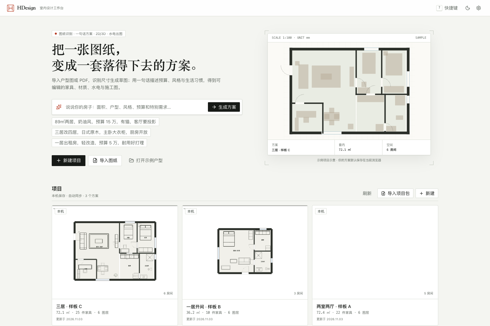
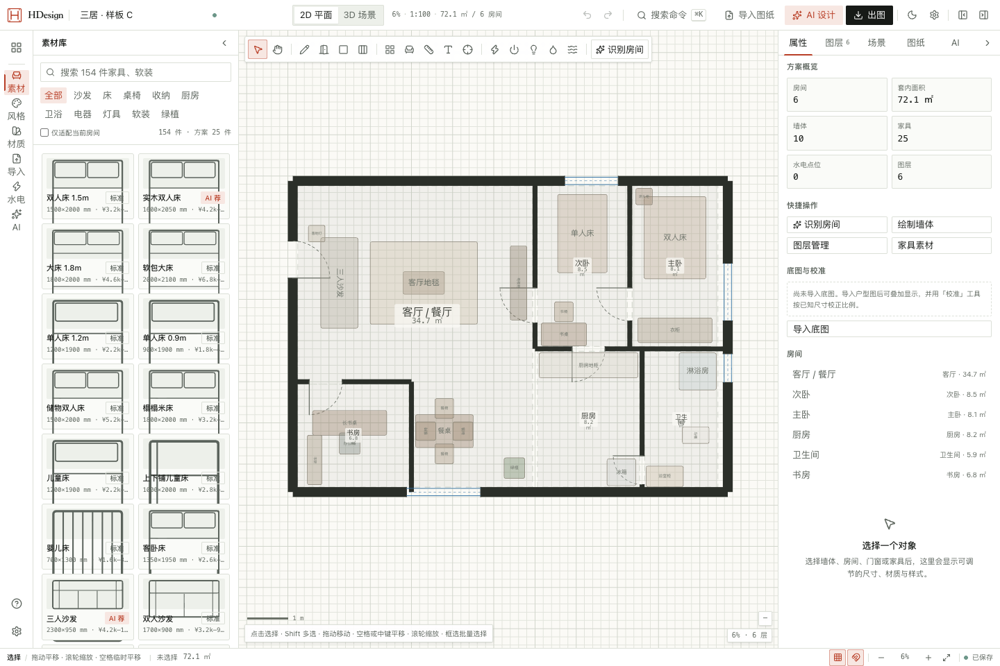
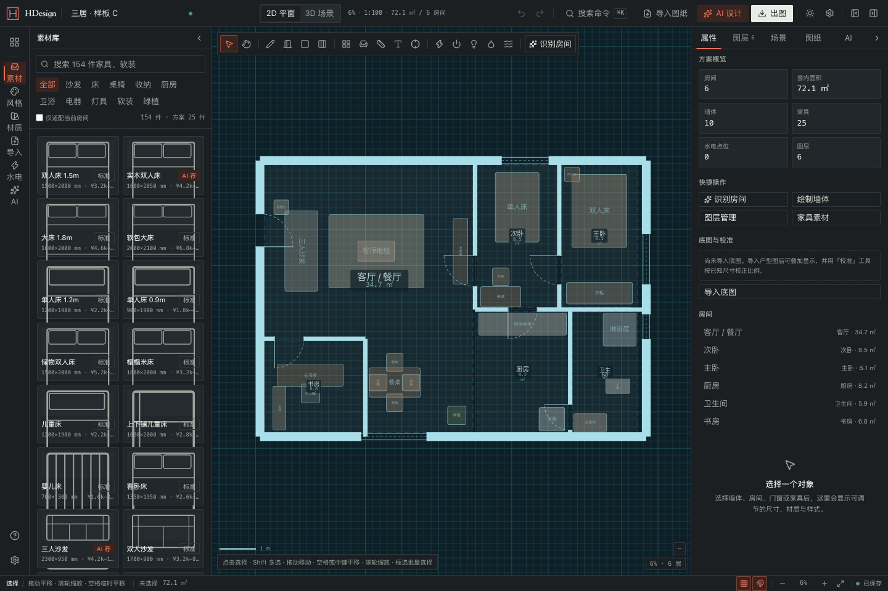
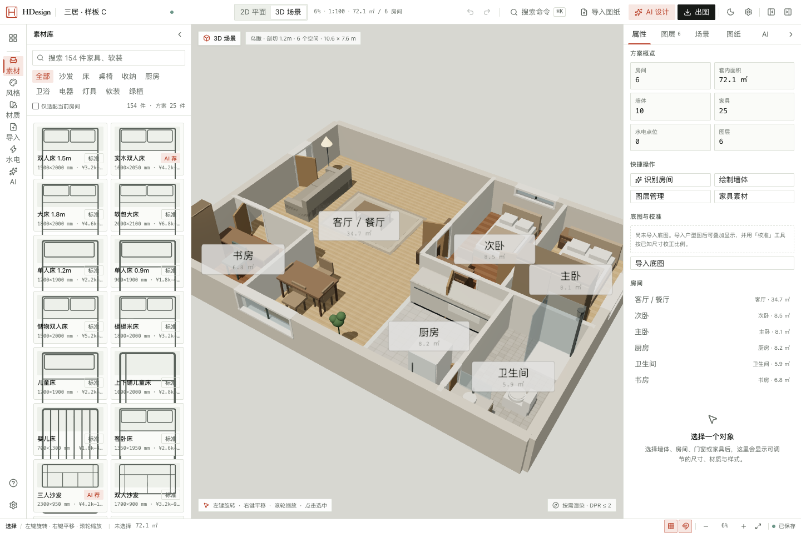
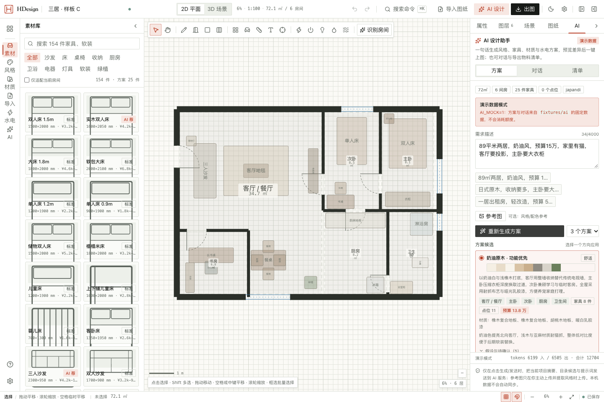
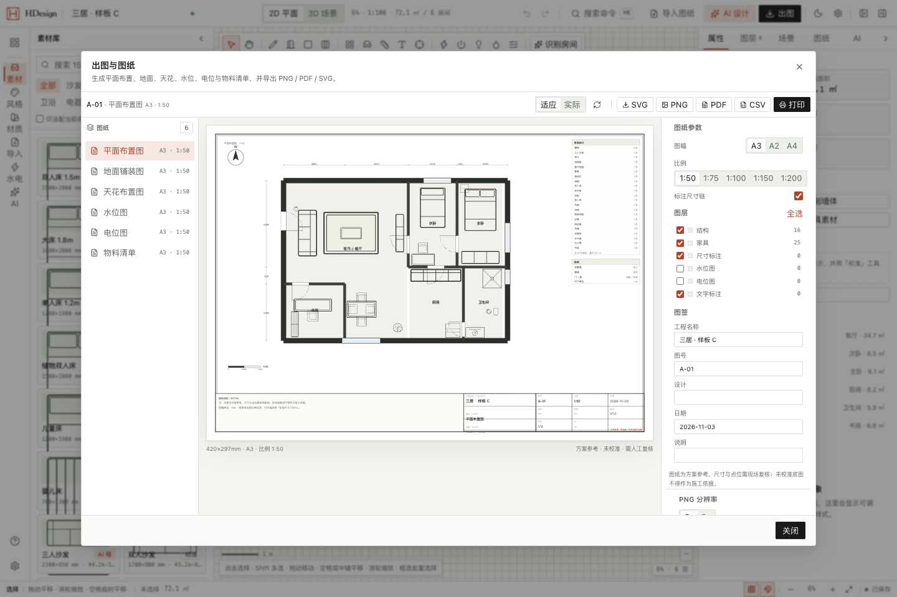
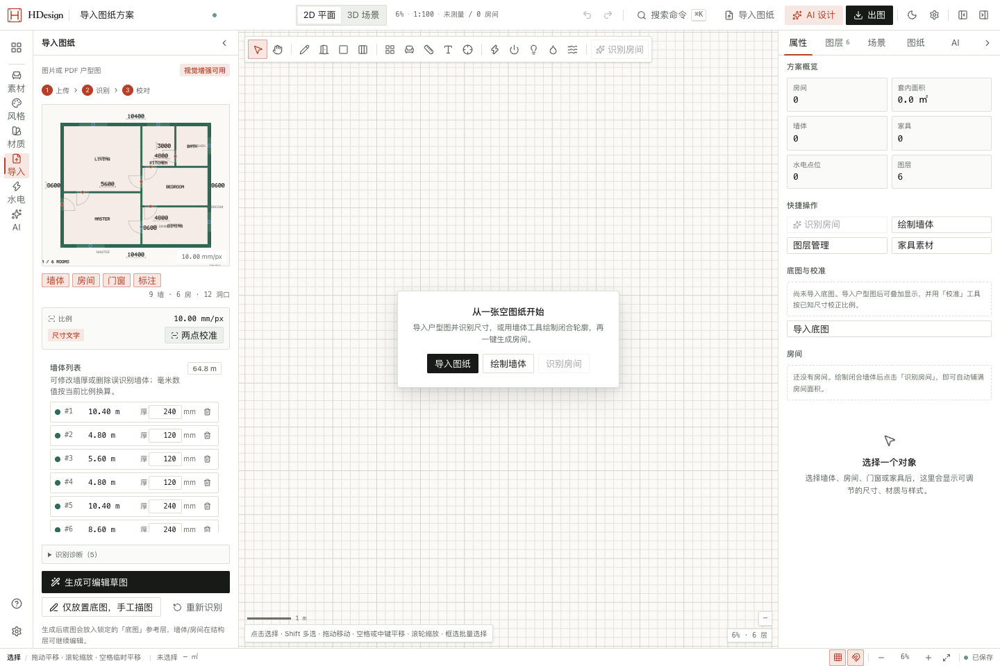

# HDesign · 室内设计工作台

把一张户型图纸变成可编辑、可出图的设计方案：导入图片/PDF 识别墙体和尺寸，用一句话生成风格、家具、材质与水电点位，在 2D/3D 中核对，最后输出平面布置、地面、天花、水位、电位与物料清单。

> 本地优先：项目、底图和对话保存在浏览器 IndexedDB，不上传服务器。AI 仅通过本地 Hono 代理调用 DeepSeek（OpenAI 兼容），不配置密钥时 CAD、风格、3D、出图等全部功能仍可使用。



## 界面预览

| 2D 制图（浅色） | 2D 制图（蓝晒） |
|---|---|
|  |  |

| 3D 剖切鸟瞰 | AI 方案候选 |
|---|---|
|  |  |

| 图纸与出图 | 图纸识别校对 |
|---|---|
|  |  |

深色主题、1024px 紧凑布局等更多截图见 `docs/screenshots/`。

## 快速开始

```bash
pnpm install
pnpm dev
```

- Web：http://localhost:5173
- API：http://localhost:8791（Vite 将 `/api` 代理到该端口）
- 生产：`pnpm build && pnpm start`（服务端同时托管构建后的前端）

环境要求：Node ≥ 22.12、pnpm 11、支持 WebGL2 的桌面浏览器（Chrome/Edge/Safari 最新两个大版本）。

### 配置 AI（可选）

```bash
cp .env.example .env
# 编辑 .env
AI_API_KEY=sk-...
# 默认 AI_BASE_URL=https://api.deepseek.com, AI_MODEL=deepseek-flash
```

`deepseek-flash` 同时支持 JSON 输出与视觉输入；结构化任务默认关闭 thinking 以降低延迟。重启 API 后生效。设置面板会显示连接状态与模型名。端到端演示可用 `AI_MOCK=1` 回放确定性数据（UI 标注演示）。

### 脚本

| 命令 | 说明 |
|---|---|
| `pnpm dev` | 同时启动 web 与 api |
| `pnpm build` | 构建全部包与前端 |
| `pnpm start` | 生产模式启动 API + 静态前端 |
| `pnpm typecheck` | 全仓库 TypeScript 检查 |
| `pnpm lint` | ESLint |
| `pnpm test` | Vitest 单元测试 |
| `pnpm e2e` | Playwright 端到端（Chromium 安装在 `.playwright-browsers`） |
| `pnpm fixtures` | 生成合成图纸识别夹具 |
| `pnpm setup:ocr` | 下载本地 OCR 资源（可选，`apps/web/public/ocr/` 不入库） |
| `node scripts/probe-parse-plan.mjs <plan.png>` | 视觉提示词回归探针：墙体厚度 / 标注线误判 / 比例误差 |

`pnpm e2e` 会自动构建生产包，并在 8793 端口启动 `AI_MOCK=1` 的确定性服务（已运行时复用）；
共 15 条用例覆盖导入、2D、3D、AI 一键上图、出图、项目包与无障碍。当前单元/集成测试约 338 条。

## 功能

- **图纸导入与识别**：PNG/JPG/WebP/PDF（多页），本地 CV 提取墙体、房间与尺寸文字，可选 DeepSeek Vision 增强门窗与标签；两点比例校准、叠图校对、生成可编辑草图；识别失败可退化为底图手工描图。
- **2D 编辑器**：墙体/门窗/房间/家具/标注/测量/水电点位；吸附、对齐、碰撞提示、多选变换、尺寸链、图层显隐与锁定、撤销/重做；支持纸面与蓝晒画布。
- **风格与素材**：12 套风格预设、100+ 家具、材质库；一键应用风格与自动布置；支持参考图取色生成本地自定义风格。
- **AI 设计助手**：一句话生成 2–3 套方案（风格/家具/材质/水电/预算），预览变更后一键上图；自然语言微调（换色、换家具、加家具、移动、重排房间）；物料清单由本地几何计算并可导出；DeepSeek 流式对话。
- **水电点位**：按房间规则生成水位/电位点位与回路，可拖动、改高度/回路、按房间统计，图纸与 3D 同步。
- **2D / 3D**：参数化家具与墙体挤出、门窗洞口、顶视/鸟瞰/四角/第一人称漫游、日光与剖切显示、选中同步。
- **出图**：平面布置、地面铺装、天花布置、水位图、电位图、物料清单；标题栏、尺寸链、图例、比例尺；SVG/PNG/PDF/CSV 导出与 A3 打印。
- **项目**：本机多方案、自动保存、复制/删除、`.hdz` 导入导出（含底图资产）。

## 技术栈

React 19 · Vite 8 · TypeScript 5.9 · Tailwind CSS 4 · Konva/react-konva · three/@react-three/fiber · Zustand · Dexie · zod · pdfjs-dist · tesseract.js · Hono · DeepSeek API（OpenAI 兼容） · Vitest · Playwright。

Monorepo 结构：

```
apps/web            React SPA（编辑器、面板、2D/3D、服务层）
apps/server         Hono AI 代理（DeepSeek 视觉/文本、SSE 对话）
packages/domain     zod 数据模型、几何、房间、撤销协议、AI 契约
packages/catalog    家具/材质/风格预设
packages/symbols    2D 与图纸共用的 SVG 符号
packages/autolayout 确定性家具布置与水电规则
packages/plan-recognition 本地 CV/OCR 识别
packages/drawing    SVG 图纸渲染与导出
```

更多设计说明：[架构](docs/architecture.md) · [AI 设计工作流](docs/ai-design.md) · [图纸识别](docs/recognition.md)。

## 数据与隐私

- 项目、底图、对话只存本机 IndexedDB；清理站点数据会丢失，请用 `.hdz` 导出备份。
- 图纸识别默认在浏览器内完成；启用 AI 时会发送降采样图片与项目摘要到配置的服务端/模型，需在设置页确认。服务端不落盘项目或图片，不记录提示词与密钥。
- 生成的方案与图纸为设计参考，不构成施工依据；识别与 AI 结果必须人工确认。

## 已知限制

- 识别针对常见正交户型图；手绘、严重模糊或异形图纸需手工描图修正。
- 暂不支持曲线墙、楼梯生成、照片级渲染、多人协作与云同步；水电回路为方案级提示，不做规范合规判定。
- 移动端为浏览与基础操作；完整编辑推荐 ≥1280px 桌面端。

## 许可

本项目用于演示与二次开发。第三方依赖遵循各自许可证（three.js、Konva、pdf.js、Tesseract.js 等）。
